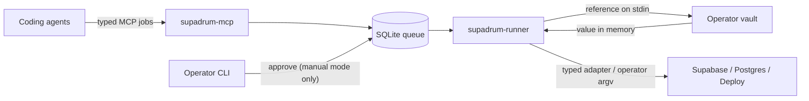

# Supadrum

Supadrum is a small credential broker for coding agents that operate Supabase
projects. Agents declare a project and an atomic intent; the runner owns
credentials, chamber rotation, execution, and verification. By default it does
not add a second human decision gate after a capability has been granted.

Projects that ship application builds can also declare the `deploy`
capability: `deploy.inspect` reads deployments, `deploy.plan` rehearses
(pull, build), and `deploy.apply` ships through operator-owned `commands`
templates and an optional `deploy_token` credential, leaving the same audited
trail as a migration.

No resolved credential—and no `vault://` reference—enters a job payload or the
durable queue.

## Why Supadrum keeps secrets out of LLM context

Supadrum is local-first and open source. There is no hosted Supadrum secret
service and no telemetry path that sends credential material to the project
maintainers. The implementation and its security boundaries can be audited
directly in this repository.

When using the bundled macOS flow:

- the operator enters each value through a masked local TTY;
- the CLI writes it to
  [macOS Keychain](https://support.apple.com/guide/security/keychain-data-protection-secb0694df1a/web),
  an encrypted database protected by operating-system access controls;
- project configuration contains only `vault://` references;
- Supadrum never places resolved credential values in MCP messages or LLM
  prompts; agents receive project aliases, capabilities, job state, and
  redacted results;
- secret values do not enter job payloads, SQLite, the repository, argv, shell
  history, or CLI output;
- the runner resolves credentials in local process memory only when executing
  an operator-authorized command, then redacts exact values from captured
  stdout and stderr.

This removes standing plaintext credentials from the project directory and
reduces accidental exposure compared with a repo-local `.env`, especially when
coding agents can read workspace files.

This is a Supadrum data-flow guarantee, not a sandbox guarantee. An agent or
other process with unrestricted shell access running as the same macOS user
shares that user's Keychain security boundary and may be able to invoke local
credential tooling directly. Hard isolation requires running the broker under
a dedicated OS identity that the agent cannot access, or using an external
vault with independently enforced identity and policy. Open source is an
auditability benefit, not a security guarantee. See
[`SECURITY.md`](SECURITY.md) for the full threat model.



## What works

- Complete remote credential bundles: `secret_key`, `management_token`,
  `database_access`, plus optional `deploy_token`.
- Fourteen catalog capabilities (`data-api`, `auth-admin`, `storage`,
  `realtime`, `edge-functions`, `secrets`, `migrations`, `schema-inspection`,
  `sql`, `adapter-tests`, `pgtap`, `stack`, `project-management`, `deploy`)
  covering 26 operations:
  - **Safe `executor: dry-run` (default)** accepts every catalog operation for
    queuing, policy, and verification testing with zero external side effects.
  - **Live Supabase / local execution (`executor: command`, `mode: live`)** runs
    built-in typed adapters (`LiveSupabaseExecutor`) with output redaction and
    repository SHA/OID verification.
  - **Live `deploy.*` execution** routes to operator-owned `commands` YAML argv
    templates (`CommandExecutor`) with optional Vercel `deploy_target` pinning
    (`VERCEL_ORG_ID` and `VERCEL_PROJECT_ID`).
- **Implemented live vs dry-run boundaries:**
  - `data.query` (`data-api`), `realtime.admin` (`realtime`), and
    `project.manage` (`project-management`) are accepted in `dry-run`, but
    currently have no live adapter (`No live adapter` in `live` mode).
  - Remote live chambers execute `project.inspect`, `migration.plan`,
    `migration.baseline` (Prisma), `migration.apply`, `types.generate`,
    `schema.inspect`, `functions.deploy`, `secrets.set`, `sql.execute`,
    `storage.admin`, and operator-configured `deploy.*`.
  - Local chambers (`target: local`) allow 10 capabilities (`migrations`,
    `auth-admin`, `sql`, `adapter-tests`, `pgtap`, `stack`, `schema-inspection`,
    `storage`, `edge-functions`, `secrets`) and require
    `migration_driver: supabase`. `migration.diff`, `auth.admin`, `tests.run`,
    `pgtap.run`, `stack.serve`, `functions.invoke`, `functions.workers.stop`,
    `functions.workers.activate`, `functions.runtime.restart`, and
    `secrets.check` are local-only; `functions.deploy` is remote-only;
    `schema.inspect` currently supports remote chambers with `database_access`
    and is not wired for `target: local` yet.
- Durable FIFO jobs with idempotency, event cursors, optional manual approvals,
  cancellation, verification, and expired-lease recovery.
- FIFO skipping of `waiting_credentials` and `waiting_approval` jobs without
  reordering executable work.
- Chamber reuse for consecutive jobs on one project and
  `drain → unmount → mount` rotation on project changes.
- Interactive capability-scoped sessions with optional manual approval,
  heartbeat, TTL, and automatic release.
- A stdio MCP server with the nine tools from the original design.
  For clients that reject dots in tool names, set
  `SUPADRUM_MCP_TOOL_NAMES=portable` in that server process. The catalog then
  uses underscores (for example, `projects_inspect`). Job operation IDs are
  independent of this setting.
- A Codex plugin bundle with a mandatory Supadrum workflow skill.

## Requirements

- Node.js 22 or newer; Node.js 24 LTS is recommended. On Linux (`arm64`) with
  Node.js 22, the bundled `better-sqlite3` (`13.0.2`) native addon requires
  `glibc >= 2.38` (such as Ubuntu 24.04 or Debian 13).
- macOS Keychain for the bundled local `keychain` backend and bundled `sops`
  age identity custody (`darwin`), or external stdin/stdout helpers via
  `vault_command` (reads) and optional `vault_write_command` (writes for
  `supadrum project credentials set` and local `tests.run`; required off macOS
  where interactive credential setup or adapter-test password provisioning is used).
- `git`, `supabase` (`2.116.0` or newer for `pgtap`/`stack`), `psql`, `docker`
  (for local stacks, `pgtap`, and `stack`), `tar` (for pgTAP), and `prisma` when
  `migration_driver: prisma`.

## Platform validation status

- **macOS (`darwin`):** primary operator environment where bundled `keychain`
  (`security`), `defaultVaultCommand`, `sops` age Keychain bootstrap, and
  local `tests.run` / `auth.admin` Keychain custody are implemented and used.
- **Native Windows x64 (`win32`/`x64`) — private validation at revision `b80beac`:**
  - Verified on `windows-2025` (Node.js 22, `npm@11.21.3`): `npm ci`,
    `npm run build`, `npm run typecheck`, targeted Vitest suites
    (`test/cli.test.ts`, `test/mcp.test.ts`, `test/local-stack.test.ts` — 3
    files, 94 tests), and packed-tarball install into a space-containing path
    with stdio MCP smoke (`projects.inspect` and
    `SUPADRUM_MCP_TOOL_NAMES=portable` `projects_inspect` on a synthetic
    `dry-run` project).
  - Scope boundary: establishes that `npm ci` works, build/typecheck pass, the
    tested CLI/setup path handling and SQLite queue work, and packed-tarball
    stdio MCP works. Does not cover the remaining Vitest files, live
    Docker/Supabase/PostgreSQL execution, pgTAP/stack, or vault resolution.
- **WSL2 (`linux`/`x64`) — private validation at revision `4dc938d`:**
  - Verified inside Ubuntu on WSL2 (`microsoft-standard-WSL2`, Node.js
    `v22.23.5`, `npm` `10.9.9`, `build-essential` and `python3` installed, Linux
    filesystem checkout): `npm ci`, `npm run build`, `npm run typecheck`,
    `npm pack`, and packed-tarball stdio MCP smoke (`projects.inspect` and
    `SUPADRUM_MCP_TOOL_NAMES=portable` `projects_inspect` on a synthetic
    `dry-run` project).
  - Scope boundary: establishes WSL2 Linux dependency install (`npm ci`), build,
    typecheck, and packed-tarball MCP stdio transport from a Linux filesystem.
    Does not cover Vitest suites, `/mnt/` Windows-mounted checkouts, integrated
    local stack execution, or vault resolution.
- **Linux ARM64 (`linux`/`arm64`) — observed `glibc >= 2.38` requirement:**
  - Observed on Debian 12 (`linux`/`arm64`, Node.js 22): `better-sqlite3`
    `13.0.2` loads its prebundled native addon requiring `GLIBC_2.38` and fails
    even when source builds are requested.
  - Distribution requirement: use a distribution providing `glibc >= 2.38`
    (for example, Ubuntu 24.04 or Debian 13).
- **Outstanding cross-platform gaps in this repository:**
  - Bundled Keychain and SOPS age identity custody require macOS. Linux and
    Windows use the external vault commands below. A real provider and live
    adapter execution still need platform validation.
  - Live Windows execution still needs end-to-end verification across native
    executables, Docker, pgTAP, and NTFS permissions. File modes such as
    `0o600` and `0o700` do not set NTFS access-control lists.
  - Integrated WSL2 local stack execution (`supabase start`, Docker loopback,
    Vite `.env.development.local`, `supadrum-runner`, pgTAP, disposable stacks)
    is pending end-to-end verification.

## Quick start

```bash
npm install
npm run build
npm link

supadrum --help
supadrum demo
```

`project add` may be launched from any directory. Given only an alias, it looks
for a matching Git repository in the current directory, beside it, and under
the common `~/Documents`, `~/Developer`, and `~/Projects` roots. It discovers
the Supabase project ref from linked CLI metadata or an allow-listed public
Supabase URL (plus `.vercel/project.json` for optional deploy target pinning).
Conflicting metadata stops registration instead of guessing.

```bash
cd /path/to/supadrum
supadrum project add example-ios
```

For a local Supabase stack, `--local` creates a local chamber (`target: local`)
and live project with `migrations` enabled:

```bash
supadrum project add example-local --local --repo /absolute/path/to/example
supadrum project start example-local
```

If discovery is incomplete for a remote project, the wizard asks only for the
missing repository or project ref. Flags make registration deterministic for
scripts:

```bash
supadrum project add example-ios \
  --repo /absolute/path/to/example-ios \
  --project-ref abcdefghijklmnopqrst \
  --profile development \
  --yes
```

The wizard creates an owner-only (`0600`) dry-run config, records the absolute
repository, generates the credential references, and probes vault readiness
without printing values. On `darwin`, `project add` sets `vault_command` to the
bundled Keychain resolver when none is configured. It also makes the target
repository Codex-ready:

- `.agents/skills/supadrum/` receives the bundled workflow skill;
- `.codex/config.toml` receives an owner-independent, repository-scoped
  `supadrum` MCP entry pointing at the absolute operator config;
- `AGENTS.md` receives a small managed block requiring Supadrum for every
  Supabase task;
- existing direct Supabase MCP entries are preserved with `enabled = false`.

These writes are idempotent and preserve unrelated Codex settings and agent
instructions. Start a new Codex task after registration so it discovers the
skill and MCP server. Pass `--no-agent-setup` to skip agent configuration.

Available remote registration profiles are `inspect` (`data-api`,
`schema-inspection`, `project-management`), `development` (`data-api`,
`storage`, `edge-functions`, `migrations`, `schema-inspection`,
`project-management` — default), and `admin` (all catalog capabilities except
`pgtap` and `stack`, which require `target: local`). Capability grants are the
authorization boundary; jobs run automatically unless the operator sets
`approval_mode: manual`.

Manage registered projects and runs with:

```bash
supadrum project list
supadrum project setup example-ios
supadrum project inspect example-ios
supadrum project start example-local
supadrum project capabilities set example-ios storage edge-functions schema-inspection
supadrum project credentials set example-ios
supadrum project credentials set example-ios --replace database_access
supadrum project migrations owner example-ios
supadrum project migrations driver example-ios prisma
supadrum project live example-ios
supadrum project dry-run example-ios
supadrum project doctor --all
supadrum status <job-id>
supadrum approve <job-id> --actor operator --config ./supadrum.yml
supadrum pgtap example-local <tree-oid>
supadrum stack example-local <tree-oid> -- npm run test:e2e
```

`supadrum project setup <alias>` also installs or repairs the Codex agent
configuration by default (pass `--no-agent-setup` to skip). `doctor` and
`credentials set` check the three required Supabase credentials (`secret_key`,
`management_token`, `database_access`); optional `deploy_token` is set via
`credentials set` when declared on the project or chamber and is not probed by
`doctor`.

Configuration lookup is, in order: `--config`, `SUPADRUM_CONFIG`, a local
`supadrum.yml`, a local `.supadrum/config.yml`, then
`$XDG_CONFIG_HOME/supadrum/config.yml` or
`~/.config/supadrum/config.yml`. (`supadrum pgtap` and `supadrum stack`
deliberately skip repo-local `supadrum.yml` and `.supadrum/config.yml` so
repository files cannot supply broker configuration inside hooks.)
`supadrum init` creates a starter `supadrum.yml` with mode `0600`.

Start both processes; they use the same configuration discovery:

```bash
supadrum-runner [--once] [--poll-ms 250]
supadrum-mcp
```

`supadrum-runner` writes `runner.pid` beside `database_path` and restarts its
loop when the config file changes while idle (which closes any active session).
`supadrum-mcp` keeps `database_path` and `approval_mode` fixed for the process
lifetime and hot-reloads project/capability changes per request on config mtime
change (keeping the last valid config if a broken edit is saved).

For repositories registered through `project add/setup`, Codex starts
`supadrum-mcp` from `.codex/config.toml`. The standalone
[`examples/mcp.json`](examples/mcp.json) remains available for other MCP
clients.

## Vault backends

The runner and operator CLI can use an external resolver via `vault_command`
on macOS, Linux, and Windows. It receives one `vault://` reference on stdin
and returns only the value on stdout. Exit code 44 means an absent entry.
Other failures abort credential setup. Agents cannot invoke the resolver
through MCP.

For masked credential setup or local adapter tests that store generated
passwords, configure an explicit `vault_write_command` alongside
`vault_command`. Both are argv lists. Use a native executable or an explicit
interpreter and script path. Supadrum starts the writer without a shell and
sends one JSON line with `reference` and `value` on stdin. The value must be
nonempty without leading or trailing whitespace. Exit zero signals a write,
which Supadrum verifies through the resolver. Helper output is kept out of
job and CLI results. The helper and its storage policy are operator-owned.
Local Auth on Linux and Windows needs only the resolver.

macOS keeps Keychain as the default for local adapter tests and Auth unless
an external writer is explicitly configured.

```yaml
version: 1
executor: command
vault_command: [/absolute/path/to/vault-read, --profile, prod]
vault_write_command: [/absolute/path/to/vault-write, --profile, prod]

chambers:
  example-platform:
    project_ref: abcdefghijklmnopqrst
    credentials:
      secret_key: vault://supabase/example-platform/secret
      management_token: vault://supabase/example-platform/management
      database_access: vault://supabase/example-platform/postgres

projects:
  example-web:
    repo: /absolute/path/to/example-web
    chamber: example-platform
    mode: live
    capabilities:
      - migrations
```

To populate a registered project's credential bundle through masked prompts
(using Keychain on macOS, or `vault_write_command` alongside `vault_command`):

```bash
supadrum project credentials set example
supadrum project doctor example
```

The command asks only for missing values, validates `database_access` as a
complete PostgreSQL URI, writes each value to Keychain or the configured
`vault_write_command`, and verifies the round trip via the resolver. `--replace`
deliberately rotates one existing entry. Values never enter argv, shell history,
config, or CLI output.

For non-interactive automation on macOS, `keychain put` accepts one value on
stdin and `keychain import` migrates an existing Keychain generic-password
item:

```bash
printf '%s' "$VALUE" |
  supadrum-vault keychain put vault://supabase/example/management

supadrum-vault keychain import vault://supabase/example/management \
  --service existing-service --account "$USER"
```

Configure `vault_command: [supadrum-vault, keychain, resolve]`. `keychain put`
and `keychain import` print reference metadata only; values are encoded in
process memory and sent to macOS `security -i` over stdin.

For SOPS/age encrypted bundles on macOS (`darwin`), bootstrap an age identity
into macOS Keychain (`vault://supadrum/keys/age`):

```bash
supadrum-vault sops bootstrap-age
```

The command prints only the public recipient. Resolve a SOPS bundle with:

```yaml
vault_command:
  - supadrum-vault
  - sops
  - resolve
  - --file
  - /absolute/path/to/secrets.enc.json
```

See [`examples/sops-age`](examples/sops-age/README.md) for setup and threat
model details. **macOS boundary:** SOPS and age are operator-installed tools,
not npm dependencies, and bundled `supadrum-vault` (`keychain`,
`sops bootstrap-age`, `sops resolve`, and `migrate dotenv`) requires `darwin`
and fails outside macOS because private age identity custody
(`vault://supadrum/keys/age`) is hardwired to macOS Keychain. On Linux and
Windows, wire external SOPS wrappers, OpenBao, Infisical, or OS secret-store
helpers through `vault_command` (and `vault_write_command` when interactive
setup or adapter-test writes are needed).

For initial ingestion on macOS, `supadrum-vault migrate dotenv` copies only
explicit `--map NAME=vault://reference` entries to Keychain and a verified
SOPS backup. It previews by default; `--apply` atomically removes those
plaintext assignments after every round-trip succeeds.

## MCP surface

```text
projects.list()
projects.inspect(project)

jobs.submit(project, operation, payload, repo_sha, idempotency_key)
jobs.wait(job_id, cursor, timeout_ms)   # cursor >= 0 (default 0), timeout_ms 0..30000 (default 30000)
jobs.status(job_id)
jobs.cancel(job_id)

sessions.open(project, capability, repo_sha, idempotency_key, ttl_ms)  # ttl_ms 1000..900000 (default 60000)
sessions.exec(session_id, operation, payload, idempotency_key)
sessions.close(session_id)
```

The default `approval_mode: automatic` queues authorized jobs immediately.
Operators who explicitly set `approval_mode: manual` add a human gate to
mutating jobs (and to `sessions.open` when the leased capability covers any
approval-gated operation; once open, `sessions.exec` submits jobs with
`requires_approval: false`). Approval intentionally does not exist in MCP:

```bash
supadrum approve <job-id> --actor operator --config ./supadrum.yml
```

Then the agent resumes `jobs.wait` from its last cursor.

### Coded errors

Anything a caller can provoke comes back as a tool error carrying a code, so
an agent can tell a denial from a not-yet:

```json
{
  "error": {
    "code": "session_not_active",
    "message": "Session is not active: 0f0c…",
    "retryable": true
  }
}
```

`retryable` is `true` only for `session_not_active` (the lease exists, but its
open job has not been granted yet). Every other `BrokerErrorCode` has
`retryable: false` and requires a different caller input or state change:
`unknown_project`, `unknown_job`, `unknown_session`, `capability_denied`,
`approval_not_required`, `invalid_input`, `idempotency_conflict`,
`job_state_conflict`, `session_state_conflict`, and `internal_invariant`.

`internal_invariant` indicates the broker rejected its own state transition; a
failure with no code at all is an unhandled crash, not a protocol answer.

### Generated types

`types.generate` writes the TypeScript types of one schema (`public` by
default) into a repository file via `supabase gen types typescript`, using
`management_token` on remote chambers or `--local` after loopback preflight
on local chambers. Same `schema-inspection` capability, no approval; the
generated text stays on disk and only its relative path, SHA-256 digest, and
byte count return in `verification` (`jobs.submit` arguments):

```json
{
  "project": "example-web",
  "operation": "types.generate",
  "payload": { "output": "src/types/supabase.ts", "schema": "public" },
  "repo_sha": "abc123",
  "idempotency_key": "example-web:abc123:types-public"
}
```

### Read-only schema contracts

`schema.inspect` verifies database contracts using parameterized, read-only
catalog queries (`default_transaction_read_only=on`, `statement_timeout=5000`,
`lock_timeout=1000`, `PGSSLMODE=require`) against remote `database_access`
chambers with the `schema-inspection` capability (no approval, supports both
`supabase` and `prisma` migration history; not yet wired for `target: local`).
Example `jobs.submit` call:

```json
{
  "project": "example-remote",
  "operation": "schema.inspect",
  "payload": {
    "checks": [
      {
        "kind": "migration",
        "version": "20260729164000"
      },
      {
        "kind": "relation",
        "schema": "public",
        "name": "games"
      },
      {
        "kind": "column",
        "schema": "public",
        "relation": "games",
        "name": "played_at"
      },
      {
        "kind": "trigger",
        "schema": "public",
        "relation": "games",
        "name": "games_updated_at"
      },
      {
        "kind": "routine",
        "schema": "public",
        "name": "create_game_for_user",
        "argument_types": ["uuid", "uuid"]
      }
    ]
  },
  "repo_sha": "abc123",
  "idempotency_key": "example-remote:abc123:schema-contract-v1"
}
```

The same operation's `payload` can also certify structural RLS state and
effective privileges:

```json
{
  "checks": [
    {
      "kind": "row-security",
      "schema": "public",
      "relation": "templates",
      "enabled": true,
      "force": false,
      "roles_without_bypass": ["anon", "authenticated"]
    },
    {
      "kind": "policy",
      "schema": "public",
      "relation": "templates",
      "name": "templates_update",
      "command": "UPDATE",
      "roles": ["authenticated"],
      "permissive": true
    },
    {
      "kind": "schema-privilege",
      "schema": "private",
      "role": "authenticated",
      "privilege": "USAGE",
      "granted": true
    },
    {
      "kind": "relation-privilege",
      "schema": "public",
      "relation": "templates",
      "role": "anon",
      "privilege": "SELECT",
      "granted": false
    },
    {
      "kind": "routine-privilege",
      "schema": "private",
      "name": "is_organization_member",
      "argument_types": ["text"],
      "role": "authenticated",
      "privilege": "EXECUTE",
      "granted": true
    }
  ]
}
```

`row-security` compares `ENABLE` and `FORCE` independently and rejects requested
roles that are missing, superusers, or carry `BYPASSRLS`. `policy` matches the
exact command, role set, permissive/restrictive mode, and the command-aware
presence of `USING` and `WITH CHECK`; it never returns expression bodies.

Privilege checks use PostgreSQL's effective privilege predicates, so inherited
and `PUBLIC` grants are included. Supported schema privileges are `USAGE` and
`CREATE`; relation privileges are `SELECT`, `INSERT`, `UPDATE`, `DELETE`,
`TRUNCATE`, `REFERENCES`, `TRIGGER`, and `MAINTAIN`; routine privileges support
`EXECUTE`. `MAINTAIN` requires PostgreSQL 17 or later. A negative requirement
uses `"granted": false`.

The runner verifies the requested repository SHA before database access and
matches routines that are functions (`prokind = 'f'`, exposed as Supabase RPCs).
Requests contain 1–100 checks, serialized `checks` JSON is capped at 64 KiB
(`65536` UTF-8 bytes), PostgreSQL identifiers at 63 UTF-8 bytes, and routine
signatures at 64 arguments of at most 255 UTF-8 bytes each. A completed result
with `compatible: false` reports unsatisfied requirements without failing the
job; policy checks verify structure, not predicate semantics.

### Storage objects

`storage.admin` lists, downloads, uploads, and deletes Storage objects through
the Storage REST API using `secret_key` and `project_ref` on remote chambers,
or the verified loopback service key from `supabase status` on local chambers.
It requires the `storage` capability and is approval-gated. Buckets are
read-only, and upload/delete refuse bucket names matching Storage routes
(`sign`, `upload`, `list`, `info`, `public`, `authenticated`, `move`, `copy`).

Object paths and contents never appear in the job result, verification, or
errors: results carry counts, byte totals, and SHA-256 digests, while paths
stay only in files written under `dest`. `dest` must be relative to the
repository, confined to it, covered by `git check-ignore`, empty or absent, and
not `.git` (case-insensitive) or reached through a symlink.

```json
{ "action": "list" }
{ "action": "list", "dest": "backups/storage-list" }
```

`list` pages buckets 1,000 entries at a time and returns per-bucket `name`,
`public`, `objects`, and `bytes`, plus totals. With `dest` it also writes `LIST`
(`bucket/path`, bytes, timestamp) and returns `list_sha256` and `list_bytes`.

```json
{ "action": "download", "dest": "backups/storage-2026-10-27" }
{ "action": "download", "dest": "backups/storage-2026-10-27", "buckets": ["avatars"] }
```

`download` requests `Accept-Encoding: identity` (300 s timeout per request,
1,024-char object path limit), enforces `256 MiB` free disk headroom before
fetching, verifies body size against `Content-Length` and listing bytes, saves
objects under `dest/<bucket>/<path>`, and writes `MANIFEST` (`sha256`, bytes,
`bucket/path`).

```json
{
  "action": "upload",
  "bucket": "avatars",
  "object": "team/logo.png",
  "path": "assets/logo.png",
  "digest": "0123456789abcdef0123456789abcdef0123456789abcdef0123456789abcdef",
  "content_type": "image/png"
}
```

`upload` pins the SHA-256 `digest` of a repository file (no `.git` or symlink)
and requires `content_type`; an existing object fails unless `"upsert": true`.

```json
{
  "action": "delete",
  "bucket": "avatars",
  "objects": ["team/old-logo.png"],
  "dest": "backups/storage-before-delete"
}
```

`delete` accepts up to 100 distinct exact object paths (no prefixes or
wildcards), downloads all named objects into `dest` with `MANIFEST` first, and
deletes only if every download succeeded.

## Job states

```text
queued
waiting_credentials
waiting_approval
granted
running
verifying
completed
failed
cancelled
lease_expired
```

Only `completed` means success.

- The runner grants one active job at a time with a default `60000` ms lease;
  stale `granted`, `running`, or `verifying` jobs transition to
  `lease_expired` on `Runner.tick()`.
- `jobs.cancel` cancels `queued`, `waiting_credentials`, `waiting_approval`, or
  `granted` jobs, and rejects `running` or `verifying` jobs with
  `job_state_conflict`.
- If a credential check fails while `running` (`MissingCredentialsError`), the
  job returns to `waiting_credentials` so it does not block other FIFO work.
- `waiting_approval` is used by `approval_mode: manual` and legacy queued jobs;
  an automatic runner records `approved_by: policy:automatic` when releasing
  legacy jobs.

## Configuration

Start from [`examples/supadrum.yml`](examples/supadrum.yml). Physical Supabase
backends are chambers; logical applications point to them:

```yaml
version: 1
approval_mode: automatic

chambers:
  example-platform:
    project_ref: abcdefghijklmnopqrst
    credentials:
      secret_key: vault://supabase/example-platform/secret
      management_token: vault://supabase/example-platform/management
      database_access: vault://supabase/example-platform/postgres

projects:
  example-web:
    repo: /absolute/path/to/example-web
    chamber: example-platform
    mode: live
    migrations: owner
    migration_driver: prisma
    capabilities:
      - migrations
      - schema-inspection

  example-ios:
    repo: /absolute/path/to/example-ios
    chamber: example-platform
    mode: live
    migrations: consumer
    capabilities:
      - storage
      - edge-functions
      - schema-inspection
```

Projects default to `dry-run` (unless `executor: command` is set and `mode` is
omitted); `supadrum project live <alias>` validates the repository and core
credential bundle before enabling only that alias. Consecutive aliases on one
chamber reuse its mounted credentials. A different chamber causes drain and
rotation. The global FIFO grants only one job (or active session) at a time.

### Local chambers, Edge Functions, and workers

Local chambers (`target: local`) operate against a loopback Docker/Supabase
stack without stored chamber credentials (`supadrum project start <alias>`
ensures a `127.0.0.1`-bound Docker network, starts `supabase`, and updates
Vite `.env.development.local` when `auth.external_url` is configured). They
support the 10 local capabilities (`migrations`, `auth-admin`, `sql`,
`adapter-tests`, `pgtap`, `stack`, `schema-inspection`, `storage`,
`edge-functions`, `secrets`) with `migration_driver: supabase`. Note that
`schema.inspect` currently has no local live adapter even though
`schema-inspection` is accepted for `types.generate`.

Local chambers can also register operator-owned Edge Functions, runtime
secrets, and `pg_cron` worker jobs:

```yaml
version: 1
executor: command
vault_command: [supadrum-vault, keychain, resolve]

chambers:
  example-local:
    target: local
    managed_secrets:
      WEBHOOK_TOKEN: vault://examples/local/webhook-token
    local_worker_jobs:
      - dispatch-notifications
    local_functions:
      healthcheck:
        identity: anon
      user-sync:
        identity: account
        account: user_one
    local_runtime:
      secrets: [WEBHOOK_TOKEN]
      probe: healthcheck
      network: supadrum-example-loopback
      workers:
        schedule_sql:
          - supabase/workers/schedule.sql
        autostart: true
    auth_password_accounts:
      user_one:
        user_id: 00000000-0000-4000-8000-000000000001
        email: user1@example.test
        password_ref: vault://examples/local/user-one

projects:
  example-local:
    repo: /absolute/path/to/example-local
    chamber: example-local
    mode: live
    migrations: owner
    capabilities:
      - migrations
      - sql
      - storage
      - edge-functions
      - secrets
      - auth-admin
```

- `functions.invoke` (`edge-functions`, approval-gated) POSTs JSON (max 64 KiB
  request/response) to a registered function in `local_functions` on loopback,
  returning only HTTP status and response byte count.
- `secrets.check` (`secrets`, approval-gated) verifies that named
  `managed_secrets` resolve without revealing values or references.
- `secrets.set` (`secrets` + `edge-functions`, approval-gated) on `target: local`
  must name every secret in `local_runtime.secrets` and delegates to
  `functions.runtime.restart`.
- `functions.runtime.restart` stops registered `local_worker_jobs`, re-verifies
  the `127.0.0.1`-bound Docker network before and after `supabase stop` /
  `supabase start --network-id` (passing resolved `local_runtime.secrets` in
  process env for `[edge_runtime.secrets]` in `supabase/config.toml`), calls the
  `probe` function, and activates workers only when `autostart: true`.
- `functions.workers.stop` / `functions.workers.activate` toggle only
  `local_worker_jobs` via committed `schedule_sql` files (max 256 KiB, read from
  the pinned `repo_sha`, rejecting any backslash `\`).

### Local Supabase Auth password accounts

For a local demo whose seed already contains `auth.users` placeholders linked to
`public.users`, register the exact Auth user ID and email in
`auth_password_accounts` on the `target: local` chamber (the password itself
lives only in the vault). Use
`supadrum-vault keychain put vault://examples/local/user-one` at an operator
terminal to store a unique password (`>= 12` chars), then submit the
approval-gated `auth.admin` job:

```json
{
  "project": "example-local",
  "operation": "auth.admin",
  "payload": {
    "adapter": "supabase-password",
    "action": "upsert",
    "account": "user_one"
  },
  "repo_sha": "abc123",
  "idempotency_key": "example-local:abc123:auth-user-one"
}
```

The broker verifies `auth.users` and `public.users`, normalizes missing GoTrue
fields on that row, updates password and email confirmation through local Auth
Admin, and verifies password login (`POST /auth/v1/token?grant_type=password`
and `GET /auth/v1/user`) before reporting `completed`.

### Pinned local adapter tests and personal database logins

`tests.run` is available only on a live `target: local` chamber with
`adapter-tests`. The operator registers an npm script, `writer_password_ref`,
optional `writer_role` (`atlas_session_writer` or `atlas_graph_writer`),
optional `setup_sql_path`, `personas` (must include `student`, `staff`,
`outsider`), and optional `password_accounts` / `database_logins`. Personal
database logins (`role` must be `atlas_cost_owner` or `atlas_session_operator`,
name ending with `_<person>` with hyphens turned to underscores, and no
person name a suffix of another) ensure `session_user` identifies who acted:

```yaml
version: 1
executor: command
vault_command: [supadrum-vault, keychain, resolve]

chambers:
  example-local:
    target: local
    auth_password_accounts:
      user_one:
        user_id: 00000000-0000-4000-8000-000000000001
        email: user1@example.test
        password_ref: vault://examples/local/user-one
    database_logins:
      cost_owner_alex:
        role: atlas_cost_owner
        person: alex
        password_ref: vault://examples/local/cost-owner-alex
    adapter_tests:
      sessions:
        npm_script: test:adapter
        writer_password_ref: vault://examples/local/writer-password
        writer_role: atlas_session_writer
        setup_sql_path: database/supabase/fixtures/adapter-contract.sql
        password_accounts: [user_one]
        database_logins: [cost_owner_alex]
        personas:
          student: 00000000-0000-4000-8000-000000000011
          staff: 00000000-0000-4000-8000-000000000012
          outsider: 00000000-0000-4000-8000-000000000013

projects:
  example:
    repo: /absolute/path/to/example
    supabase_dir: database
    chamber: example-local
    mode: live
    capabilities: [sql, adapter-tests]
```

For a suite with `setup_sql_path`, first submit `sql.execute` for that
repository file with its SHA-256 `digest` at the same `repo_sha`; once
completed, submit `tests.run` with
`{"script":"sessions","setup_job_id":"<completed SQL job UUID>"}`. Before
running, the broker verifies `HEAD === repo_sha`, a clean git checkout, and a
loopback Supabase stack; replays `setup_sql_path`; provisions fresh random
passwords in macOS Keychain (or `vault_command` + `vault_write_command`, both
required off macOS) and sends only SCRAM-SHA-256 verifiers to PostgreSQL; and
checks role attributes, function ACLs, and absence of table/column/sequence/create
grants (see [`SECURITY.md`](SECURITY.md)).

The test child receives `ATLAS_WRITER_DATABASE_URL` (direct stack DB port, not
the pooler), `ATLAS_DATA_API_URL`, `ATLAS_ANON_KEY`, `ATLAS_<PERSONA>_JWT`,
selected `SUPADRUM_AUTH_<NAME>_EMAIL` / `SUPADRUM_AUTH_<NAME>_PASSWORD` (when
`password_accounts` is used, captured `stdout`/`stderr` are suppressed), and
selected `ATLAS_LOGIN_<NAME>_DATABASE_URL` (for PostgreSQL role
`supadrum_atlas_<name>`). Record and retire personal database logins in
[`docs/database-logins.md`](docs/database-logins.md).

To prove the personal-login guard on a real PostgreSQL 16+ cluster, point
`SUPADRUM_THROWAWAY_PG_URL` at a disposable loopback cluster and run
`npx vitest run test/personal-login-guard.pg.test.ts`.

### Disposable pgTAP and stack runs

`pgtap.run` (`pgtap` capability) and `stack.serve` (`stack` capability) extract
a full 40- or 64-character hex git **tree OID** into `~/.cache/supadrum`
(`supadrum-tmp-<alias>`) and boot a disposable loopback Docker Supabase stack on
free ports starting at `pgtap.port_base` (`56321`), leaving manual local stacks
untouched. Both require `executor: command`, `mode: live`, `target: local`, a
`[a-z0-9-]` project alias, and a chamber `pgtap` block:

```yaml
version: 1
executor: command
pgtap:
  queue_timeout_ms: 120000
  port_base: 56321
  min_free_gib: 5

chambers:
  example-local:
    target: local
    pgtap:
      tests_path: supabase/tests
      start_timeout_ms: 300000
      test_timeout_ms: 120000

projects:
  example-local:
    repo: /absolute/path/to/example-local
    chamber: example-local
    mode: live
    capabilities: [pgtap, stack]
```

Run `supadrum pgtap <alias> $(git write-tree)` for pgTAP hooks, or
`supadrum stack <alias> $(git write-tree) -- <command...>` to run Playwright or
Deno suites with `SUPADRUM_*`-prefixed `supabase status -o env` variables. Full
details, limits, and exit codes are documented in
[`docs/pgtap.md`](docs/pgtap.md) and [`docs/stack.md`](docs/stack.md).

### Migrations, Prisma baselines, and deploy

`migration_driver` accepts `supabase` (default) or `prisma`. Only one project
per chamber may set `migrations: owner`.

- **Supabase remote**: plans with `supabase db push --dry-run --linked` and
  applies with `supabase db push --linked --yes` (relinking via session pooler
  on IPv4-only networks; connection password stays in env).
- **Supabase local**: runs `supabase db push --dry-run --local`, `db push --local`,
  or `migration.diff` (`supabase db schema declarative sync --no-apply --strict-coverage`).
- **Prisma remote**: runs `prisma migrate status`, `prisma migrate deploy`, and
  `migration.baseline` (`prisma migrate resolve --applied <name>` over a clean,
  tracked contiguous prefix of `prisma/migrations`), passing `DATABASE_URL` and
  `DIRECT_DATABASE_URL` in env. Supadrum resolves the installed Prisma
  package's Node entrypoint. `SUPADRUM_PRISMA_BIN` can point to an executable
  or a JavaScript entrypoint.

Projects declaring `deploy` configure operator-owned `commands` (single `argv` or
multi-step `steps`) and optional `deploy_target`:

```yaml
version: 1
executor: command
vault_command: [supadrum-vault, keychain, resolve]

chambers:
  example-prod:
    project_ref: abcdefghijklmnopqrst
    deploy_target:
      provider: vercel
      project_id: prj_example123
      org_id: team_example123
    credentials:
      secret_key: vault://supabase/example-prod/secret
      management_token: vault://supabase/example-prod/management
      database_access: vault://supabase/example-prod/postgres
      deploy_token: vault://vercel/example-prod/token

projects:
  example-web:
    repo: /absolute/path/to/example-web
    chamber: example-prod
    mode: live
    capabilities: [deploy]
    commands:
      deploy.plan:
        argv: [vercel, build, "--prod"]
        env:
          VERCEL_TOKEN: deploy_token
      deploy.apply:
        steps:
          - argv: [vercel, pull, "--yes", "--environment=production"]
          - argv: [vercel, build, "--prod"]
          - argv: [vercel, deploy, "--prebuilt", "--prod"]
        env:
          VERCEL_TOKEN: deploy_token
```

Supported template variables in `commands` argv are `{{project_ref}}`,
`{{repo_sha}}`, `{{deploy_project_id}}`, `{{deploy_org_id}}`, and scalar
`{{payload.<path>}}` fields (`deploy_target` values always come from operator
config, never job payloads).

## Security model

- Project YAML is operator-owned policy, not agent input.
- MCP schemas reject sensitive payload keys, PostgreSQL URLs, and vault
  references.
- The vault resolver receives `<reference>\n` over stdin (`vault_command`), and
  external writers receive a JSON line `{"reference":"...","value":"..."}\n`
  over stdin (`vault_write_command`) with helper stdout/stderr ignored and
  `shell: false`; references and values never enter `argv`.
- Supadrum handles resolved values in runner or operator CLI memory and passes
  them only to authorized child processes. External helpers own their storage
  and access policy.
- In `executor: command`, live Supabase/local operations run built-in typed
  adapters (no shell), while live `deploy.*` runs operator-owned `commands` argv
  with `shell: false`.
- The bundled `supadrum-vault` CLI (`keychain`, `sops`, `migrate dotenv`)
  keeps SOPS age identity custody (`vault://supadrum/keys/age`) in macOS
  Keychain (`darwin`-only) and passes `SOPS_AGE_KEY` only to the SOPS child
  environment; off macOS, configure external `vault_command` (and
  `vault_write_command` when writes are required).
- Persisted stdout and stderr are redacted with all resolved values.
- Automatic mode treats configured capabilities as the authorization decision;
  manual approvals remain available only through the operator CLI.
- Sessions lease exactly one capability and block the global queue until close
  or expiry.
- The safe default (`executor: dry-run`) has zero external effects.

Read [`SECURITY.md`](SECURITY.md) before enabling live mode.

## Development

```bash
npm run typecheck
npm run check
npm run build
npm run smoke
npm pack --dry-run
```

The default `npm test` suite uses temporary SQLite databases and never contacts
Supabase. Live integration tests are opt-in:
`SUPADRUM_THROWAWAY_PG_URL=... npx vitest run test/personal-login-guard.pg.test.ts`
and `SUPADRUM_DOCKER_TESTS=1 npx vitest run test/pgtap.docker.test.ts`.

## License

Apache-2.0. See [`LICENSE`](LICENSE).
